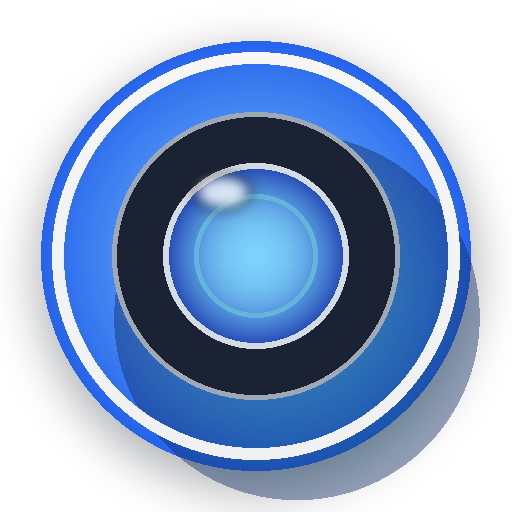

<p align="center">
  
</p>

<h1 align="center">Camera Overlay</h1>

<p align="center">
  <strong>A circular, always-on-top webcam bubble for Linux.</strong><br>
  Tune the look in a native settings window, preview live, then float it over every app.
</p>

<p align="center">
  <a href="#install">Install</a> ·
  <a href="#how-it-works">How it works</a> ·
  <a href="#controls">Controls</a> ·
  <a href="#project-layout">Project layout</a>
</p>

---

## Why it exists

Meetings, streams, and demos often need a small face cam that stays visible without stealing focus. **Camera Overlay** gives you a clean circular bubble that stays above other windows, moves freely, and stays out of the way until you need it.

## Features

- Native **GNOME / libadwaita** settings (English, LTR)
- **Live preview** before launch
- Slider controls for **resolution**, **brightness**, **warmth**, and **zoom**
- Optional **background soft-blur**
- Circular **always-on-top** overlay
- Drag to move, rim-drag to resize, scroll to zoom
- Hover-only close button
- Stable window identity: `Camera Overlay` / `CameraOverlay`

## Install

```bash
./install.sh
```

This will:

1. Install system packages when needed (`ffmpeg`, GTK/Adwaita GI bindings)
2. Create `.venv` and install Python deps from `requirements.txt`
3. Generate `assets/icon.png`
4. Install a desktop launcher under `~/.local/share/applications/`

### Run

```bash
./run.sh
```

Or launch **Camera Overlay** from your app menu.

### Requirements

| Layer | Packages |
| --- | --- |
| Python (`.venv`) | `PyQt5`, `Pillow` |
| System | `ffmpeg`, `python3-gi`, `gir1.2-gtk-4.0`, `gir1.2-adw-1` |

## How it works

```text
┌──────────────────────────┐
│  Settings (GTK4 / Adw)   │
│  live preview + sliders  │
└────────────┬─────────────┘
             │ Run
             ▼
┌──────────────────────────┐
│ Overlay (Qt, frameless)  │
│ circular always-on-top   │
└────────────┬─────────────┘
             │
             ▼
        ffmpeg / V4L2
        low-latency MJPEG
```

1. Open settings and adjust image + lighting while watching the live preview.
2. Press **Run** to release the camera from preview and spawn the floating overlay.
3. Drag, resize, and scroll on the bubble as needed.
4. Hover to reveal the close button, or press `Esc`.

Capture uses **ffmpeg** against `/dev/video0` with backlog frame dropping for lower latency. Effects (brightness, warmth, blur) are applied in Python before the frame is shown.

## Controls

| Action | Where | Gesture |
| --- | --- | --- |
| Move | Overlay | Drag inside the circle |
| Resize | Overlay | Drag near the rim |
| Zoom | Overlay / Settings | Scroll / Zoom slider |
| Close | Overlay | Hover + click ✕, or `Esc` |
| Launch | Settings | **Run** |

## Project layout

```text
Camera-Overlay/
├── assets/                  # App icon and static media
├── packaging/               # Desktop entry template
├── scripts/                 # Build helpers (icon generator)
├── src/camera_overlay/      # Application package
│   ├── app.py               # CLI entry / mode dispatch
│   ├── settings_window.py   # Native settings + preview
│   ├── overlay_window.py    # Floating circular overlay
│   ├── capture.py           # ffmpeg capture workers
│   ├── effects.py           # Brightness / warmth / blur
│   ├── config.py            # Overlay settings model
│   ├── constants.py         # Shared constants / identity
│   └── paths.py             # Project path helpers
├── install.sh               # One-shot installer
├── run.sh                   # Dev/runtime launcher
├── requirements.txt
└── README.md
```

## Development

```bash
./install.sh
./run.sh
```

Package import path:

```bash
PYTHONPATH=src .venv/bin/python -m camera_overlay
```

## License

Use and modify freely in your own projects unless a separate license file is added later.
